# 📚 Tansian Online Library — Web-Based Library Book Management System

Students and teachers borrow **digital copies** of books from the school library and read them **online**. Access ends automatically when the loan period is over — no overdue chasing. The librarian manages books and their files, users, borrowing records and reports.

   

---

## 🖼️ Screenshots

| | |
|:---:|:---:|
| 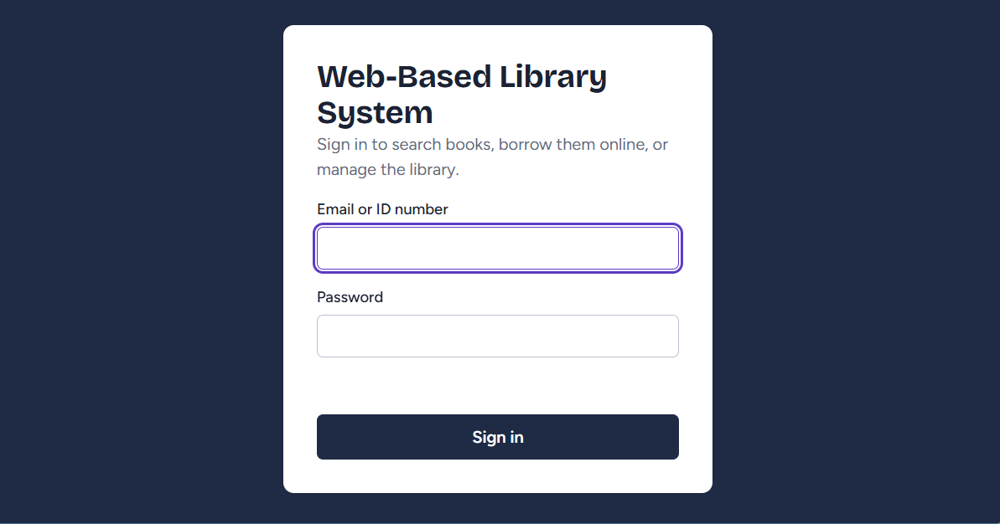 | 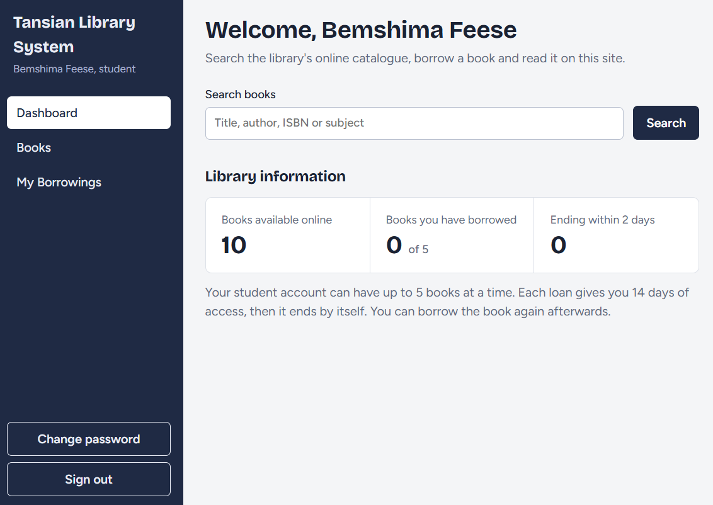 |
| **Sign in** — students, teachers and admins each get their own gateway | **Student dashboard** — search the catalogue, see loans that end by themselves |
| 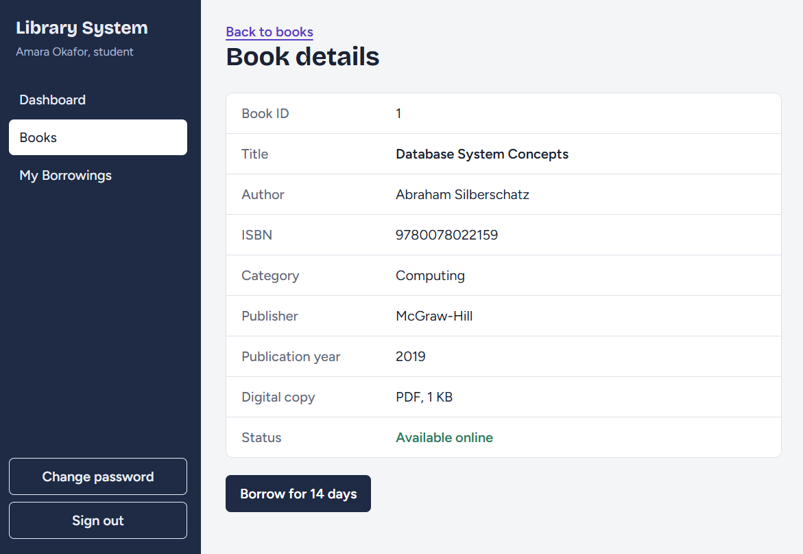 | 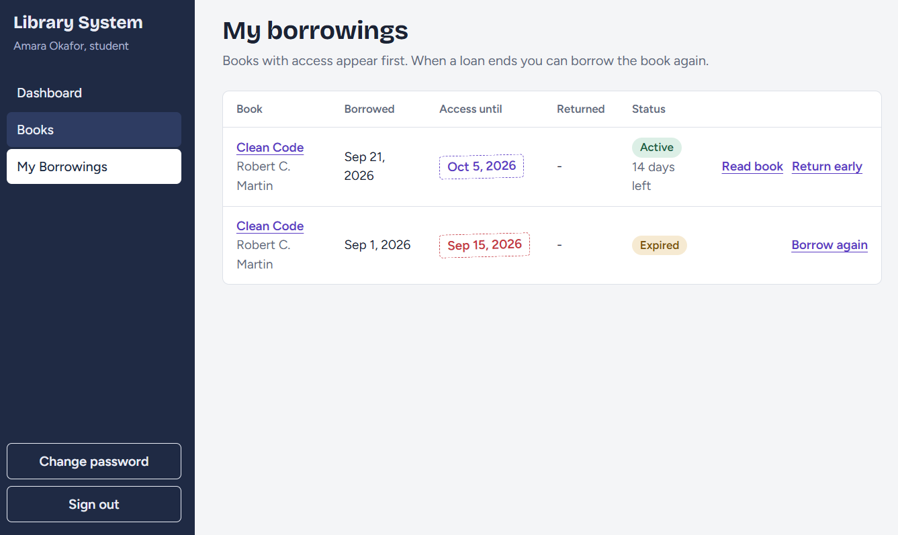 |
| **Book details** — full metadata, digital copy status and one-click borrowing | **My borrowings** — active vs. expired loans with days remaining |
| 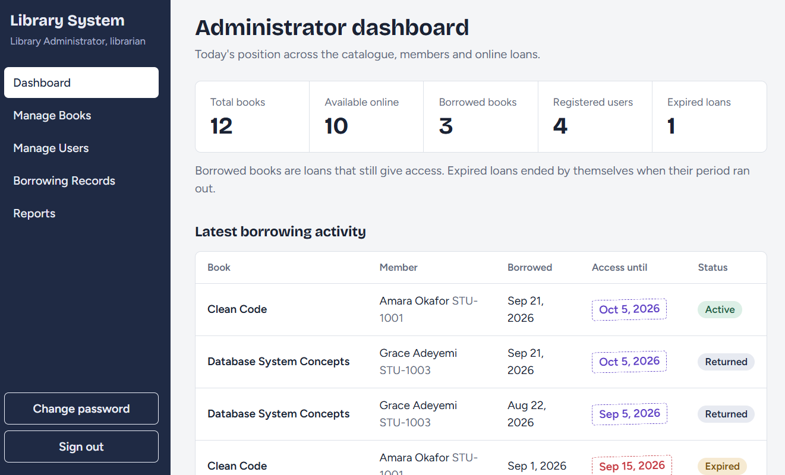 | 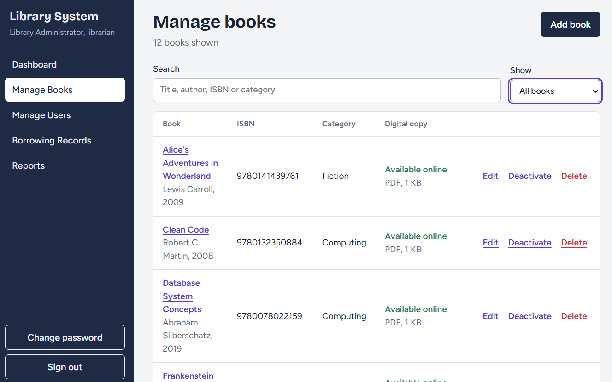 |
| **Administrator dashboard** — catalogue, members and loan position at a glance | **Manage books** — add, edit, deactivate or delete books and upload PDF/EPUB copies |
| 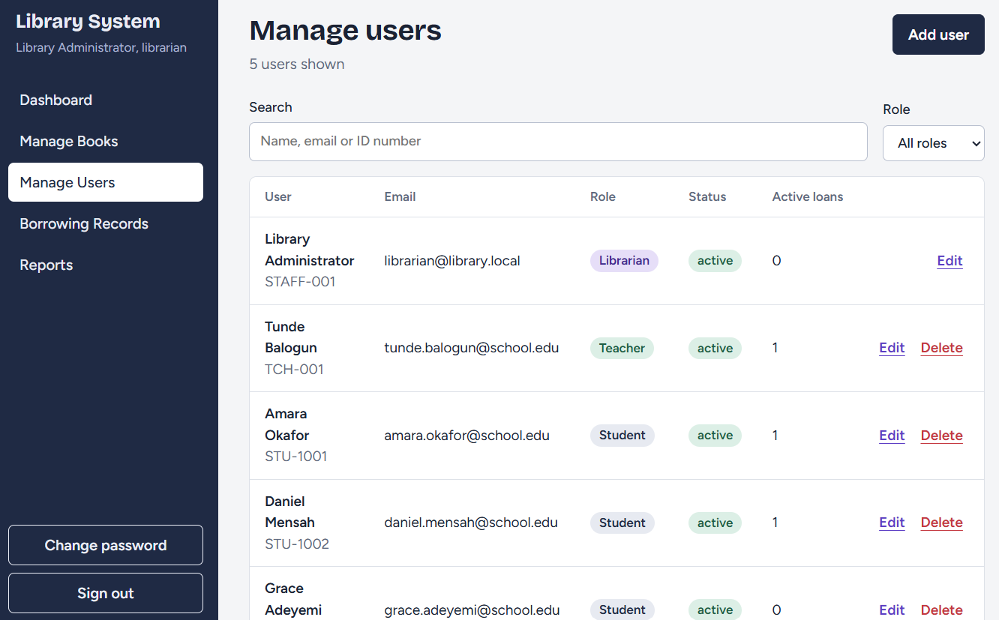 | 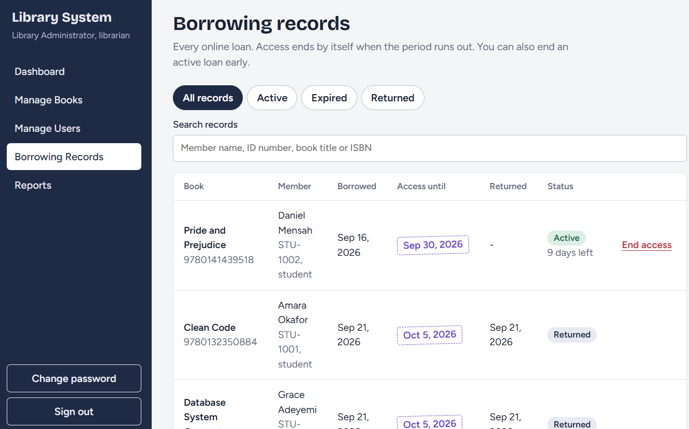 |
| **Manage users** — roles, status and active loans per member | **Borrowing records** — every loan with filters; end active loans early |

## ✨ Features

**Students & teachers**
- 🔍 Search the online catalogue by title, author, ISBN or subject
- 📖 Borrow books with a digital copy and **read them in the browser**
- ⏳ Loans end automatically (14 days for students, 30 for teachers) — borrow again afterwards
- 📥 Return early, review borrowing history, change password

**Librarian (administrator)**
- 📤 Manage books + upload digital copies (PDF/EPUB)
- 👥 Manage users — students, teachers and fellow administrators
- 📊 View all borrowing records, end loans early, and see dashboard reports
- 🗜️ Roles-based access: separate admin sign-in, route-level middleware protection

**System**
- 🔐 Session-based auth with hashed passwords (bcrypt) + signed HTTP-only cookies (JWT)
- 🛡️ Author-pages middleware keeps every admin route locked down
- ⚙️ Loan length, borrow limits and upload size are all configurable in `.env`

## 🛠️ Tech stack

| Layer | Choice |
|---|---|
| **Frontend** | HTML, CSS, vanilla JavaScript (multi-page, no frameworks) |
| **Backend** | Node.js + Express |
| **Database** | MySQL 8 (schema in `backend/database/schema.sql`) |
| **Auth** | bcrypt password hashing, JWT signed cookies, role middleware |
| **Book files** | Stored server-side in `backend/storage/books`, streamed only to members with an active loan |

## 🗃️ Database design

Three core tables — `users`, `books` and `borrow_records` — enforce roles, file metadata and loan status at the schema level:

| | | |
|:---:|:---:|:---:|
| 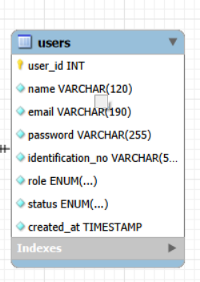 | 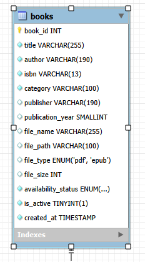 | 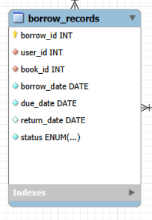 |
| `users` | `books` | `borrow_records` |

## 📁 Project structure

```
frontend/          HTML, CSS and JavaScript (public site + dashboards)
backend/
├── src/           Express routes, middleware and helpers
│   ├── routes/    auth, books, borrow, dashboard, reports, users
│   └── middleware/ auth.js — route protection by role
├── scripts/       setup-db.js, setup-admin.js, sample-pdf.js
├── database/      schema.sql — full MySQL schema
└── storage/books/ uploaded book files (not committed)
```

## 🚀 Quick start (details in `docs/SETUP-GUIDE.md`)

Install Node.js (LTS) and MySQL 8, then:

```bash
cd backend
npm install
copy .env.example .env     # then edit .env: set DB_PASSWORD and JWT_SECRET
npm run setup              # creates database, tables, sample data + sample books
npm start                  # open http://localhost:3000
```

Sample student/teacher accounts (change these passwords after signing in):

| Role | ID | Password |
|---|---|---|
| Teacher | `TCH-001` | `Teacher@123` |
| Student | `STU-1001`, `STU-1002`, `STU-1003` | `Student@123` |

## 👩‍💼 Real librarian / administrator sign-in

The librarian does **not** register through the public student/teacher form. A fresh handover ships with **no named administrator account**. After `npm run setup`, open `http://localhost:3000` — the sign-in page shows **First-time setup → Create first administrator**. The person the school designates enters their own real name, email, staff/library ID and private password, and is signed in immediately. After that, additional administrators can be created from **Manage Users → Add user → Librarian (administrator)**.

Administrator sign-in accepts an administrator email only — and the student/teacher form deliberately refuses administrator accounts.

## 📄 Docs

- 📘 [`docs/SETUP-GUIDE.md`](docs/SETUP-GUIDE.md) — how to run it
- 📐 [`docs/waterfall-documentation.md`](docs/waterfall-documentation.md) — phases, design and test plan
- 🤝 [`docs/ADMIN-HANDOVER-GUIDE.md`](docs/ADMIN-HANDOVER-GUIDE.md) — day-to-day management handover
- 📝 [`docs/CHAPTER-4-REVISIONS.md`](docs/CHAPTER-4-REVISIONS.md) — project write-up revisions

## 🔒 Security notes

- `.env` is git-ignored — secrets (DB password, JWT secret) never enter version control
- Book files are streamed **only** to members with an active loan, and access ends with the loan
- Administrator accounts can't be reached through the public registration/sign-in form

---

*Built as the Tansian school library's online lending edition — from paper queueing to self-ending digital loans.*
