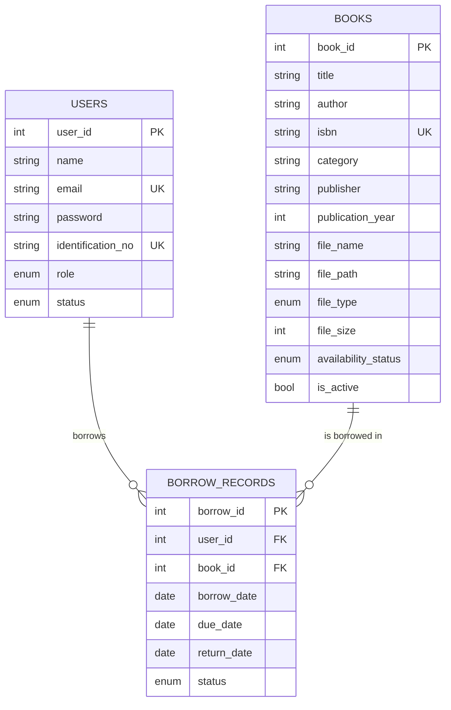

# Web-Based Library Book Management System
## Waterfall documentation, aligned to Chapter Four (online lending of digital books)

The system was built phase by phase in the waterfall order. Each phase produced a deliverable that the next phase used, and no phase was reopened without updating the document of the phase before it.

| Phase | Deliverable | Where it lives |
|---|---|---|
| 1. Requirements | Requirements and business rules | Phase 1 below |
| 2. Design | Architecture, interfaces, database, API | Phase 2 below, `backend/database/schema.sql` |
| 3. Implementation | Working code | `backend/`, `frontend/` |
| 4. Testing | Functional, business-rule, integration and security tests | Phase 4 below |
| 5. Deployment | Installation and go-live | `docs/SETUP-GUIDE.md` |
| 6. Maintenance | Maintenance plan | Phase 6 below |

`docs/CHAPTER-4-REVISIONS.md` lists exactly what to change in the Chapter Four draft so it matches this system.

---

## Phase 1: Requirements

### 1.1 The problem being solved
Students and teachers should be able to borrow books from the school library **online**: find a book, borrow a digital copy, read it on the system, and have access end automatically when the loan period is over. The librarian manages the catalogue, the digital files, the users and the reports.

### 1.2 Users
| User | Sign-in role | Main purpose |
|---|---|---|
| Student | `student` | Search books, borrow, read online, return early, view own borrowings |
| Teacher | `teacher` | Same as a student, with a longer loan period and a higher limit |
| Librarian (administrator, library staff) | `admin` | Manage books and their files, manage users, view borrowing records, end a loan, view reports |

### 1.3 Functional requirements
| ID | Requirement |
|---|---|
| FR1 | Users sign in with email or ID number and a password; invalid credentials are rejected |
| FR2 | Search the catalogue by title, author, ISBN or category; see whether an online copy exists |
| FR3 | View book details, including the format and size of the digital copy |
| FR4 | Librarian adds, edits, deactivates and deletes books, and uploads, replaces or removes the digital file (PDF or EPUB) |
| FR5 | Students and teachers borrow a book that has a digital copy; the system records the loan and sets an access end date |
| FR6 | Borrowers read (PDF) or download (EPUB) a book only while their loan is active |
| FR7 | Access ends automatically when the loan period is over |
| FR8 | Borrowers can return a book early; the librarian can end any active loan |
| FR9 | Librarian manages users and roles |
| FR10 | Users see their own borrowing records; the librarian sees all records |
| FR11 | Dashboards for users and for the librarian |
| FR12 | Reports: available books, borrowed books, returned books, expired loans, per-user records, with CSV download |

### 1.4 Business rules (loan rules are set in `backend/.env`)
| ID | Rule | Default |
|---|---|---|
| BR1 | Loan period for students | 14 days |
| BR2 | Loan period for teachers | 30 days |
| BR3 | Books a student can have borrowed at once | 5 |
| BR4 | Books a teacher can have borrowed at once | 10 |
| BR5 | Only an active book with an uploaded digital copy can be borrowed | |
| BR6 | A borrower cannot borrow a book they still have access to | |
| BR7 | The last day of access is the due date; after that the book no longer opens | |
| BR8 | After a loan ends the borrower may borrow the same book again | |
| BR9 | Inactive accounts cannot sign in or borrow | |
| BR10 | Books and users with borrowing history cannot be deleted; they are deactivated instead | |
| BR11 | Librarians cannot borrow, and cannot deactivate or delete their own account | |
| BR12 | Uploaded files must be real PDF or EPUB files, up to 50 MB | |

### 1.5 Non-functional requirements
Passwords stored only as hashes; every route except sign-in requires a valid session; book files can be opened only by people with an active loan (and the librarian); input is validated; error messages tell the user what to do next; the interface works on desktop and phone screens.

### 1.6 Out of scope for this version
Fines, reservations or waiting lists, email or SMS reminders, self-registration, an in-browser EPUB reader, and copy-protection (DRM) that could remove a file already downloaded.

---

## Phase 2: Design

### 2.1 Architecture
```
Browser  ->  Web application (Node.js + Express: API, page delivery, protected files)  ->  MySQL database
                                                   |
                                        backend/storage/books (the book files)
```
Book files live on the server's disk under random names. The database stores only the details (original name, type, size, stored name). The stored name is never sent to the browser.

### 2.2 Interfaces
| Interface | Roles | File |
|---|---|---|
| Login | All | `frontend/js/main.js` |
| Dashboard (student or teacher) | Student, teacher | `frontend/js/user-pages.js` |
| Book search | Student, teacher | `frontend/js/user-pages.js` |
| Book details, borrow, read, return early | All (actions differ by role) | `frontend/js/user-pages.js` |
| My Borrowings | Student, teacher | `frontend/js/user-pages.js` |
| Administrator dashboard | Librarian | `frontend/js/admin-pages.js` |
| Manage books (with file upload) | Librarian | `frontend/js/admin-pages.js` |
| Manage users | Librarian | `frontend/js/admin-pages.js` |
| Borrowing records | Librarian | `frontend/js/admin-pages.js` |
| Reports | Librarian | `frontend/js/admin-pages.js` |

### 2.3 Database design
Three tables and one view, defined in `backend/database/schema.sql`.



How the loan states work:

| State shown | How it is decided |
|---|---|
| Active | `status = 'Borrowed'` and `due_date` is today or later |
| Expired | `status = 'Borrowed'` and `due_date` is before today (worked out from the date; nothing has to run at midnight) |
| Returned | `status = 'Returned'`, set when the borrower or librarian ends the loan early, with `return_date` |

### 2.4 API design
| Route | Purpose | Roles |
|---|---|---|
| POST `/api/auth/login`, `/logout`, `/change-password`; GET `/api/auth/me` | Sessions | Sign-in is public |
| GET `/api/dashboard` | Dashboard figures for the caller's role | All |
| GET `/api/books`, `/categories`, `/:id` | Search, categories, details (with the caller's own loan) | All |
| GET `/api/books/:id/file` | Read or download the digital copy | Active borrower, or librarian |
| POST, PUT, PATCH `/:id/status`, DELETE `/api/books` | Book management and file upload | Librarian |
| GET, POST, PUT, DELETE `/api/users` | User management | Librarian |
| POST `/api/borrow` | Borrow a book | Student, teacher |
| GET `/api/borrow/mine` | Own borrowing records | All |
| POST `/api/borrow/:id/return` | End a loan early | The borrower, or librarian |
| GET `/api/borrow` | All borrowing records | Librarian |
| GET `/api/reports/available`, `/borrowed`, `/returned`, `/expired`, `/user/:id` | Reports | Librarian |
| GET `/api/health` | Confirms the server and database are connected | Public |

### 2.5 Security design
| Measure | How it is done |
|---|---|
| Authentication | Email or ID number plus password, checked on the server |
| Password protection | bcrypt hashes; 8+ characters with a letter and a number |
| Session management | Signed token in an `httpOnly`, `SameSite=Strict` cookie that expires after 8 hours; the account is re-checked in the database on every request |
| Role-based access | Middleware on every route; the interface also hides pages a role cannot use |
| Protected book files | Files are not in a public folder. The file route checks the sign-in cookie, then checks the database for an active loan, on every request |
| Upload safety | Only `.pdf` and `.epub`; the first bytes are checked to confirm the real type; random stored names; size limit |
| Input validation | Server-side checks on every form |
| Injection and script protection | Parameterised SQL everywhere; all user text is escaped before it is shown |
| Brute-force protection | Sign-in pauses for 15 minutes after 20 failed attempts from one address |
| Consistency | Borrowing runs inside a transaction that locks the member's row, so quick double clicks cannot beat the loan limit |

---

## Phase 3: Implementation

| Path | Contents |
|---|---|
| `backend/database/schema.sql` | Database, tables, constraints, indexes, expired-loans view |
| `backend/scripts/setup-db.js`, `sample-pdf.js` | Creates the schema and loads sample users, books, sample PDF files and loans |
| `backend/server.js` | Web server, security headers, error handling, startup checks |
| `backend/src/routes/` | `auth`, `books`, `users`, `borrow`, `dashboard`, `reports` |
| `backend/src/utils/upload.js` | File upload, type checking and storage |
| `backend/src/middleware/auth.js` | Session check and role check |
| `backend/storage/books/` | The book files (created automatically) |
| `frontend/` | Page shell, styles and the JavaScript for each role |

Technology: Node.js 18 or later, Express 4, MySQL 8 (`mysql2`), multer (uploads), bcryptjs, jsonwebtoken, helmet, express-rate-limit; plain JavaScript on the frontend with no build step.

---

## Phase 4: Testing

**Fill in the Actual result and Status columns only after you run each test on the running system.** Chapter Four's table should show the results you really observed. If a test fails, record the failure, fix it, and run it again.

### 4.1 Functional tests
| ID | Test case | Steps | Expected result | Actual result | Status |
|---|---|---|---|---|---|
| F01 | Login with valid credentials | Sign in as `STU-1003` / `Student@123` | Student dashboard opens | | |
| F02 | Login with invalid credentials | Sign in with a wrong password | "Incorrect email/ID number or password." | | |
| F03 | Search for an existing book | Search "database" | Matching books are listed | | |
| F04 | Search for a non-existing book | Search "zzzzqq" | "No book matches your search..." message | | |
| F05 | View book details | Click a title | All details are shown, including format and size | | |
| F06 | Check availability | Open "Introduction to Algorithms" | Shows "No digital copy yet"; no Borrow button | | |
| F07 | Add a book with a file | Librarian adds a book and chooses a PDF | Book listed with format and size; a student can borrow it | | |
| F08 | Update a book | Replace the file, then remove it | New file opens; after removal the book shows "No digital copy yet" | | |
| F09 | Borrow a book | Student clicks Borrow, confirms | Loan recorded; "access until" date shown; Read book button appears | | |
| F10 | Read a borrowed book | Click Read book | The file opens in a new tab | | |
| F11 | Return early | Student clicks Return early | Status becomes Returned; Read button disappears | | |
| F12 | Access expires | Set a loan's dates in the past (see setup guide 8), reload My Borrowings | Status is Expired; no Read button | | |
| F13 | Reports | Open each report | Correct records shown; CSV downloads | | |
| F14 | Deactivate a book | Librarian deactivates a book | Students can no longer find or open it | | |
| F15 | Manage users | Librarian adds a student, then signs in as that student | Sign-in works; duplicate email or ID is rejected | | |
| F16 | End access | Librarian ends an active loan | Borrower's status becomes Returned; file no longer opens for them | | |

### 4.2 Business-rule tests
| ID | Test case | Expected result | Actual result | Status |
|---|---|---|---|---|
| B01 | Student borrows a 6th book at once | Rejected: limit reached | | |
| B02 | Teacher borrows a 6th book at once | Allowed (limit is 10) | | |
| B03 | Borrow a book you still have access to | Rejected (no Borrow button; API refuses) | | |
| B04 | Borrow the same book again after it expired | Allowed | | |
| B05 | Deactivate a user, then use their open session | Access refused on the next request | | |
| B06 | Delete a book or user that has borrowing history | Rejected with advice to deactivate | | |
| B07 | Try to borrow a book that has no file | Rejected | | |
| B08 | Upload a `.txt` file renamed to `.pdf` | Rejected: not a valid PDF | | |
| B09 | Upload a file larger than the limit | Rejected with the size limit | | |

### 4.3 Integration tests
| ID | Flow | Expected result | Actual result | Status |
|---|---|---|---|---|
| I01 | Borrow: select book, check digital copy, create record, grant access | Record exists and the file opens | | |
| I02 | Return early: update record, record date, remove access | Record shows Returned and the file no longer opens | | |
| I03 | Expiry: loan passes its due date | Access refused with no action by anyone | | |
| I04 | Dashboards after borrowing and returning | Counts match the records | | |

### 4.4 Security tests
| ID | Test | Expected result | Actual result | Status |
|---|---|---|---|---|
| S01 | Open `/api/books` while signed out | 401 response | | |
| S02 | As a student, open `/api/users` | 403 response | | |
| S03 | As a student, open the file link of a book you have not borrowed | A page saying "Borrow this book to read it" | | |
| S04 | Try `http://localhost:3000/storage/books/` | Not found (files are not public) | | |
| S05 | Check the `users.password` column in Workbench | Only long `$2a$...` hashes | | |
| S06 | Enter `<script>alert(1)</script>` as a book title | Shown as plain text, not run | | |
| S07 | Fail sign-in 21 times | Sign-in pauses with a clear message | | |

---

## Phase 5: Deployment
Follow `docs/SETUP-GUIDE.md`. For live use: HTTPS, `COOKIE_SECURE=true`, a new `JWT_SECRET`, changed default passwords, a limited-rights MySQL user, and scheduled backups of both the database and `backend/storage/books`.

## Phase 6: Maintenance
| Type | Examples |
|---|---|
| Corrective | Log and fix bugs found in use; re-run Phase 4 tests after each fix |
| Adaptive | Change loan days or limits in `.env`; move to a hosted MySQL server and file storage |
| Perfective | Email reminders before access ends, an in-browser EPUB reader, reservations, member self-registration with approval, licence-based copy protection |
| Preventive | Daily backups of the database and book files, `npm audit` and dependency updates, review inactive accounts each term |

Known limitations: expiry stops the site opening a book but cannot recall a file already downloaded from the PDF viewer; a book has one digital file at a time; the last day of access is the due date itself, so a 14-day loan is readable through day 14.
